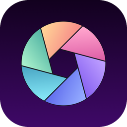

<p align="center">
  
</p>

<h1 align="center">LumiLooks</h1>

<p align="center">
  <strong>Donnez une couleur à vos idées.</strong><br>
  Studio de looks et d’étalonnage photo &amp; vidéo, gratuit, hors connexion, par <a href="https://luminosweb.com/?utm_source=github&utm_medium=referral&utm_campaign=lumilooks">LuminosWeb</a>.
</p>

<p align="center">
  <a href="https://lumilooks.luminosweb.com"><strong>⬇ Télécharger LumiLooks sur lumilooks.luminosweb.com</strong></a>
</p>

---

## Télécharger

Les installateurs officiels sont disponibles sur **[lumilooks.luminosweb.com](https://lumilooks.luminosweb.com)** (et dans les [Releases](../../releases) de ce dépôt).

| Système | Fichier | Remarques |
| --- | --- | --- |
| **Windows** 10 / 11 (x64) | `LumiLooks-<version>-Setup.exe` | Installateur en français, pour votre compte utilisateur. |
| **macOS** Apple Silicon (M1 et suivants) | `LumiLooks-<version>-macos-arm64.zip` | macOS 13 ou plus récent. Décompressez puis glissez `LumiLooks.app` dans Applications. |
| **macOS** Intel | `LumiLooks-<version>-macos-x64.zip` | Préversions signées ad hoc, pas encore notarisées : au premier lancement, clic droit → Ouvrir. |
| **Linux** Debian / Ubuntu (x64) | `lumilooks_<version>_amd64.deb` | `sudo apt install ./lumilooks_<version>_amd64.deb` |
| **Linux** portable (x64) | `LumiLooks-<version>-linux-x86_64.AppImage` | Autorisez l’exécution du fichier dans ses propriétés, puis ouvrez-le. |

Aucun compte, aucun abonnement, aucun filigrane. Vos médias restent sur votre ordinateur.

## Fonctionnalités

- **70 looks** : 19 looks LumiLooks (dont 3 looks « Optique »), 24 émulations de pellicules (Kodak, Fuji, Ilford, Agfa), DAEDAL Cinematic, slay Cinematic et OpenLUTs. Intensité réglable, favoris et looks personnels.
- **Lumière, couleur et courbes** : exposition, hautes lumières, ombres, blancs, noirs, balance des blancs, vibrance, mélangeur TSL sur 8 plages, courbes RVB et par canal, roues de colorimétrie.
- **Effets d’objectif** (inspirés de Magic Bullet Looks, implémentés en WebGL) :
  - **Haze / Flare** — voile lumineux d’une source hors champ, teinte, étendue et position réglables ;
  - **Flare anamorphique** — traînées horizontales nées des hautes lumières ;
  - **Aberration chromatique** — franges rouge / bleu vers les bords ;
  - **Distorsion de l’objectif** — barillet ou coussinet, recadrage automatique ;
  - **Diffusion optique** — halo doux façon filtre Pro-Mist.
- **Détails et pellicule** : netteté, clarté, texture, réduction du bruit, diffusion, vignettage, grain argentique.
- **Corrections colorimétriques réutilisables** : l’export **.cube** reste une LUT 3D standard (DaVinci Resolve, Premiere, Final Cut…) et contient aussi tous les réglages LumiLooks. Réimporté dans LumiLooks, il **restaure l’intégralité des paramètres**, y compris le grain et les effets qu’une LUT ne peut pas contenir. Format `.lumilook` (JSON) également disponible.
- **Vidéo** : lecture, découpe image par image, vitesse, volume, onglets Étalonnage / Montage.
- **Plein écran exclusif** (touche `F`, double-clic ou bouton) : seule l’image ou la vidéo, commandes discrètes qui disparaissent.
- **Interface** : panneaux Looks et Réglages réductibles indépendamment (`Ctrl [` / `Ctrl ]`), thème sombre ou clair, avant / après, histogramme RVB, icônes SVG pleines.
- **Export photo** : PNG, JPG, WebP ou PDF, largeur et hauteur libres avec option pour conserver les proportions d’origine.
- **Export vidéo** : MP4, WebM, MOV, AVI, WMV en 720p, 1080p, 4K ou résolution d’origine ; qualité, **débit en kbit/s**, **taille de fichier estimée**, et choix du **rendu processeur (CPU) ou carte graphique (GPU)** — NVIDIA NVENC, AMD AMF, Intel Quick Sync, Apple VideoToolbox — avec ses conséquences sur la vitesse et la qualité.

## Raccourcis

| Action | Raccourci |
| --- | --- |
| Importer des médias | `Ctrl O` |
| Ouvrir / enregistrer un projet | `Ctrl Maj O` / `Ctrl S` |
| Exporter | `Ctrl E` |
| Annuler / Rétablir | `Ctrl Z` / `Ctrl Maj Z` |
| Avant / Après · Original | `C` · `B` |
| Plein écran · quitter | `F` (ou double-clic) · `Échap` |
| Lecture / pause · entrée / sortie | `Espace` · `I` / `O` |
| Réduire les looks / les réglages | `Ctrl [` / `Ctrl ]` |

## Technologies

- **[Tauri 2](https://tauri.app)** et **Rust** pour l’application de bureau (vue web du système : WebView2, WKWebView, WebKitGTK).
- **React 19** + **TypeScript** + **Vite** pour l’interface, **zustand** pour l’état.
- **WebGL 2** : moteur couleur multi-passes partagé par l’aperçu, les vignettes et l’export (étalonnage, LUT 3D, pyramide de flou pour la diffusion, passes anamorphiques).
- **FFmpeg** (sidecar statique) pour l’analyse, le décodage et l’encodage vidéo ; les images sont étalonnées par le GPU puis encodées.
- Les médias sont servis à l’interface par un petit serveur privé sur `127.0.0.1` (requêtes partielles, jeton aléatoire par session).

## Développement

Prérequis : [Node.js 22](https://nodejs.org), [Rust stable](https://rustup.rs) et les [dépendances système de Tauri](https://tauri.app/start/prerequisites/) (sous Linux : `libwebkit2gtk-4.1-dev`, GStreamer).

```bash
npm ci
npm run ffmpeg          # télécharge FFmpeg statique pour votre plateforme (src-tauri/binaries/)
npm run tauri dev       # application de bureau en mode développement
npm run tauri build     # installateurs dans src-tauri/target/release/bundle/
```

`npm run dev` lance aussi l’interface seule dans un navigateur (import par sélecteur de fichiers, export photo par téléchargement), pratique pour travailler sur l’interface.

### Tests

```bash
npm run typecheck
npm test                          # Vitest : pipeline couleur, fichiers de correction, estimations d’export, packs LUT
cd src-tauri && cargo test        # Rust : sonde vidéo, requêtes partielles, encodeurs, géométrie, audio, PDF
python3 e2e/tauri_e2e.py <binaire> <photo> <vidéo> <dossier>   # bout en bout via tauri-driver (Linux)
```

### Structure

```
src/                 Interface React + TypeScript
  components/        En-tête, looks, aperçu, médias, montage, réglages, chaîne d’effets, export
  engine/            Aperçu WebGL, zoom, vignettes, lecture, historique
  lib/               Pipeline couleur, rendu WebGL, géométrie, formats, corrections .cube/.lumilook, packs LUT
  state/             État (zustand) et actions
src-tauri/           Backend Rust : médias, serveur local, FFmpeg, export vidéo, images/PDF, projets
public/assets/       Polices, logos, packs LUT compressés (.llut) et licences
scripts/             Icônes, packs LUT, téléchargement de FFmpeg
branding/            Logo, icônes d’application et favicons (16 → 512 px, .ico, apple-touch-icon)
.github/workflows/   CI et compilation Windows / macOS (Apple Silicon + Intel) / Linux
```

### Publier une version

1. Mettez à jour la version dans `package.json`, `src-tauri/tauri.conf.json` et `src-tauri/Cargo.toml`.
2. Poussez une étiquette (`git tag v2.0.0 && git push origin v2.0.0`) ou lancez **Actions → Build & release → Run workflow** : l’étiquette `v<version>` est alors créée automatiquement.
3. Le workflow **Build & release** compile Windows x64, macOS arm64, macOS x64 et Linux (.deb + AppImage), puis publie les fichiers et `SHA256SUMS.txt` dans une Release GitHub. Copiez-les ensuite sur [lumilooks.luminosweb.com](https://lumilooks.luminosweb.com).

## Licences et crédits

Code sous licence [MIT](LICENSE). Composants tiers, LUTs (DAEDAL CC0, slay CC BY 4.0, OpenLUTs CC0, simulations de films CC BY-SA 4.0) et FFmpeg (GPL v3, exécuté séparément) : voir [THIRD_PARTY_NOTICES.md](THIRD_PARTY_NOTICES.md). Icônes : [MingCute](https://icones.js.org/collection/mingcute) via Iconify (Apache 2.0).

Magic Bullet Looks est une marque de Maxon ; LumiLooks n’est pas affilié à Maxon et n’inclut aucun de ses composants.

---

<p align="center">Fait avec soin par <a href="https://luminosweb.com/?utm_source=github&utm_medium=referral&utm_campaign=lumilooks">LuminosWeb</a> · <a href="https://lumilooks.luminosweb.com">lumilooks.luminosweb.com</a></p>
